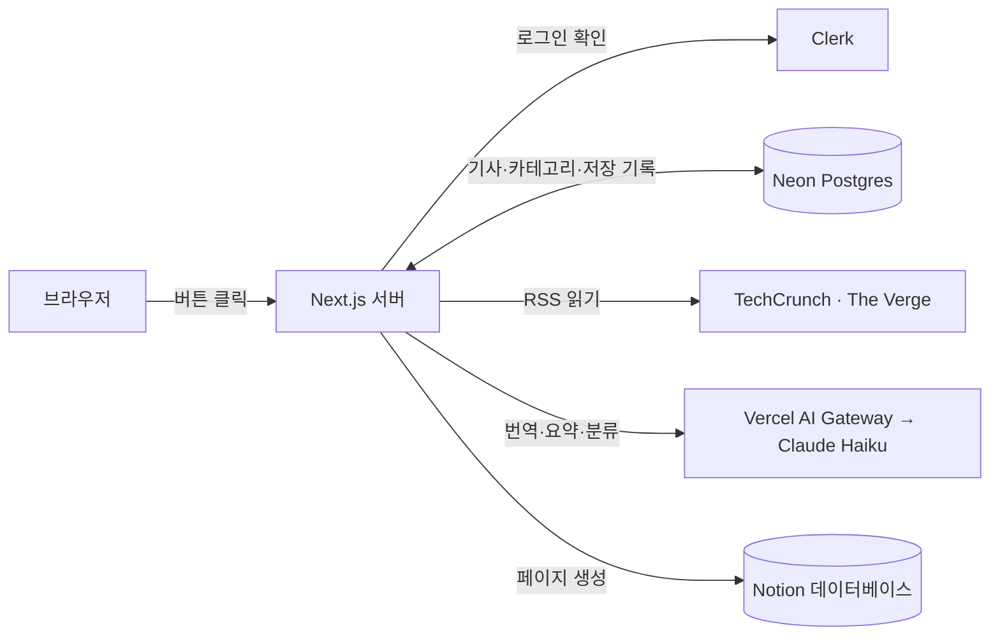

# AI뉴스 수집기

해외 AI 뉴스를 RSS로 모아 Claude로 한국어 제목·요약·카테고리를 붙이고, 카드로 보여주는 웹앱입니다. 마음에 드는 기사는 버튼 하나로 Notion 데이터베이스에 저장합니다.

- 뉴스 소스: [TechCrunch AI](https://techcrunch.com/category/artificial-intelligence/), [The Verge AI](https://www.theverge.com/ai-artificial-intelligence)
- 로그인한 사용자만 쓸 수 있고, 뉴스와 카테고리는 모든 사용자가 함께 봅니다.

## 주요 기능

| 기능 | 설명 |
|---|---|
| 로그인 | Clerk로 로그인합니다. 로그인하지 않으면 모든 화면과 API가 막힙니다. |
| 뉴스 가져오기 | 버튼을 누르면 두 RSS에서 최근 24시간 기사를 가져옵니다. 이미 있는 URL은 건너뛰고, 한 소스가 실패해도 다른 소스는 계속 처리합니다. |
| 번역·요약·분류 | 새 기사마다 Claude(Haiku)를 한 번 호출해 한국어 제목, 3~4문장 요약, 카테고리를 만듭니다. 한 번에 최대 20건, 동시에 4건씩 처리하고 나머지는 다음 가져오기 때 이어서 합니다. |
| 카드 목록 | 최신순으로 한 페이지에 9개씩 보여줍니다. 번역 전 기사는 원문 제목과 설명을 대신 보여줍니다. |
| 카테고리 필터·관리 | 카테고리별로 걸러 보고, 카테고리를 추가·수정·삭제합니다. 삭제한 카테고리의 기사는 '미분류'가 됩니다. |
| Notion 저장 | 카드의 'Notion 저장'을 누르면 Notion 데이터베이스에 한 줄로 저장되고 버튼이 '✓ 저장됨'으로 바뀝니다. 같은 기사는 다시 저장하지 않습니다. |

## 동작 구조

모든 요청은 Next.js 서버를 거칩니다. 화면에 보이는 데이터의 기준은 Neon(Postgres) 하나이고, Notion에는 저장한 기사를 쓰기만 합니다.



**뉴스 가져오기**: RSS → 새 기사만 원문으로 Neon에 저장 → 번역 안 된 기사를 Claude로 처리 → Neon에 한국어 결과 저장

**Notion 저장**: Neon에서 기사 읽기 → 이미 저장했으면 기존 링크 반환 → 아니면 Notion API로 페이지 생성 → 링크를 `notion_saves`에 기록

## 기술 스택

- **프레임워크**: Next.js 16 (App Router, Cache Components), React 19, TypeScript
- **스타일**: Tailwind CSS v4
- **인증**: Clerk (`@clerk/nextjs`)
- **DB**: Neon Postgres + Drizzle ORM, 마이그레이션은 drizzle-kit
- **AI**: Claude Haiku (`@anthropic-ai/sdk`, Vercel AI Gateway 경유), 응답은 zod로 검증
- **RSS**: rss-parser
- **Notion**: Notion API (`@notionhq/client`, 내부 integration 토큰)

## 시작하기

### 1. 준비물

- Node.js 20.9 이상
- 계정: [Clerk](https://clerk.com), [Neon](https://neon.tech), [Vercel AI Gateway](https://vercel.com/ai-gateway) API 키, [Notion](https://www.notion.so)

### 2. 설치

```bash
npm install
```

### 3. 환경변수

`.env.example`을 `.env.local`로 복사하고 값을 채웁니다. `.env.local`은 git에 올라가지 않습니다.

| 변수 | 설명 |
|---|---|
| `NEXT_PUBLIC_CLERK_PUBLISHABLE_KEY` | Clerk publishable key |
| `CLERK_SECRET_KEY` | Clerk secret key |
| `DATABASE_URL` | Neon Postgres 접속 주소 |
| `AI_GATEWAY_API_KEY` | Vercel AI Gateway API 키 (Claude 호출용) |
| `NOTION_TOKEN` | Notion 내부 integration 토큰 |
| `NOTION_DATABASE_ID` | 기사를 저장할 Notion 데이터베이스 ID |

### 4. Notion 준비

1. [Notion integrations](https://www.notion.so/profile/integrations)에서 새 integration(API 토큰 방식)을 만들고, 기능은 **콘텐츠 읽기**와 **콘텐츠 삽입**만 켭니다. 토큰을 `NOTION_TOKEN`에 넣습니다.
2. Notion에 데이터베이스를 하나 만들고 아래 속성을 **이 이름 그대로** 추가합니다.

   | 속성 | 유형 |
   |---|---|
   | 제목 | 제목(Title) |
   | 카테고리 | 선택(Select) |
   | 출처 | 선택(Select) |
   | 원문 링크 | URL |
   | 발행일 | 날짜(Date) |
   | 저장일 | 생성 일시(Created time), 선택 사항 |

3. integration 설정의 **콘텐츠 사용 권한(Content access)**에서 이 데이터베이스를 추가합니다. 빠뜨리면 저장할 때 404 오류가 납니다.
4. 데이터베이스 주소의 32자리 ID를 `NOTION_DATABASE_ID`에 넣습니다.

요약은 각 Notion 페이지의 본문에 들어갑니다. 카테고리·출처 선택지는 처음 저장할 때 자동으로 추가됩니다.

### 5. DB 마이그레이션

테이블(`categories`, `articles`, `notion_saves`)과 초기 카테고리 5개를 만듭니다.

```bash
npx drizzle-kit migrate
```

### 6. 실행

```bash
npm run dev
```

[http://localhost:3000](http://localhost:3000)을 열고 로그인한 뒤 '뉴스 가져오기'를 누릅니다.

## 명령어

| 명령 | 설명 |
|---|---|
| `npm run dev` | 개발 서버 (Turbopack) |
| `npm run build` | 프로덕션 빌드와 타입 검사 |
| `npm run start` | 빌드한 앱 실행 |
| `npm run lint` | ESLint |
| `npx drizzle-kit migrate` | DB 마이그레이션 적용 |

## 폴더 구조

```
src/
├── proxy.ts                  # 로그인하지 않은 요청을 막음
├── app/
│   ├── page.tsx              # 로그인 화면
│   ├── dashboard/            # 뉴스 카드 목록, 서버 액션, 오류 화면
│   └── categories/           # 카테고리 관리
├── components/               # 카드, 버튼, 카테고리 바, 토스트 등
├── db/schema.ts              # Neon 테이블 정의
└── lib/
    ├── rss/                  # RSS 소스와 파싱
    ├── ingest.ts             # 새 기사 저장
    ├── enrich.ts, ai/        # Claude 번역·요약·분류
    ├── articles.ts           # 목록 조회
    ├── notion.ts             # Notion API 호출
    └── notion-save.ts        # 저장 흐름과 notion_saves 기록
drizzle/                      # 마이그레이션 SQL
```

## 문서

- [`PRD.md`](./PRD.md): 기능 명세, 데이터 모델, 결정 사항
- [`ui.md`](./ui.md): 디자인 토큰, 컴포넌트 규칙, 문구 규칙
- [`CLAUDE.md`](./CLAUDE.md): 이 저장소에서 Claude Code로 작업할 때의 지침

## 사용한 플러그인

- **Frontend Design**: UI 디자인 품질 향상
- **commit-commands**: 깃 워크플로 자동화

## 설계 메모

- **뉴스는 버튼을 눌렀을 때만 가져옵니다.** 크론 같은 자동 수집은 없습니다.
- **Claude는 Vercel AI Gateway를 거쳐 부릅니다.** 연결 설정은 `src/lib/ai/client.ts` 한 곳에 있어서, Anthropic API로 직접 연결하려면 이 파일만 바꾸면 됩니다.
- **Notion 저장은 Notion API를 직접 부릅니다.** 처음에는 Claude API의 MCP 커넥터로 Notion MCP 서버를 부르려 했지만, AI Gateway가 MCP 커넥터 요청을 거절해서 직접 호출로 바꿨습니다. 저장에는 Claude가 쓰이지 않습니다.
- **카테고리 변경은 이후 가져오는 기사부터 적용됩니다.** 이미 분류한 기사는 다시 분류하지 않습니다.
